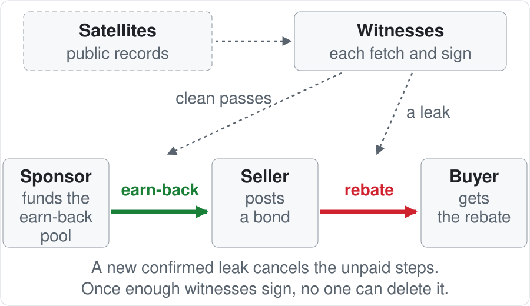

# MethaneClause

*A speed camera for methane, written into the gas contract between an EU gas importer and its supplier.*

**Live demo:** [the story on a map](https://ismailatilan-44.github.io/methaneclause/) · [try to cheat it](https://ismailatilan-44.github.io/methaneclause/?tamper=A) (60 s) · [full page](https://ismailatilan-44.github.io/methaneclause/index.html)

**Satellites confirm a leak → the seller's bond pays the buyer.**\
No new leak on later passes → the seller earns money back in steps, up to the rebate, from a sponsor's pool (for example its lender's).\
No one runs the payout: once enough independent witnesses sign the same sighting and the appeal window passes, the contract pays the buyer from the bond. The seller can appeal — then the witnesses must confirm it again — but cannot delete the sighting or hold the money.

Public satellite records are the cameras; independent witnesses (separate organisations) each fetch the record and
sign it; when enough of them sign the same leak and the appeal window passes, the seller's bond pays the buyer — the
ticket goes to the buyer, not to a state. A clean pass never undoes a paid rebate or proves a repair; it only earns
money back from the sponsor's pool.

<!-- gen:whySign:begin -->
**Why each side signs.** The buyer, an EU gas importer, must show from 1 Jan 2027 that gas bought under contracts concluded or renewed since 4 Aug 2024 is under producer-level monitoring, reporting and verification equivalent to the EU's ([Regulation (EU) 2024/1787, Art. 28](https://eur-lex.europa.eu/eli/reg/2024/1787/oj/eng)); this clause gives it an executable remedy. The seller keeps that buyer, shows a bonded commitment that buyers and lenders can check, and earns part of the rebate back with clean passes.
<!-- gen:whySign:end -->



<!-- gen:status0:begin -->
**Runs on Ethereum Sepolia (testnet):** a confirmed leak paid the buyer [SIM] (simulated party) a 0.003 ETH rebate from the seller's bond; the same signed record with its leak rate edited was refused and the bond did not move. Transactions: confirmed after the appeal window [`0x470bcc…`](https://sepolia.etherscan.io/tx/0x470bcc95bfc58a9eb316c1da588f6628156ba51c6330bf078acfaa71029a43cd), rebate withdrawn [`0xe15306…`](https://sepolia.etherscan.io/tx/0xe15306ee30432c7e92f9ccfec14ee9ea4f799cd6324f704723694159e4a819e4), refused [`0x93a4c8…`](https://sepolia.etherscan.io/tx/0x93a4c8bffda75e6b2ddedc37619e98ab1457d6038ac0872d66b49751b7a85a3f) (receipt status 0, `InvalidSignature`).
<!-- gen:status0:end -->

<!-- gen:paths:begin -->
- **Who.** The seller posts a bond for named sources; the buyer, an EU gas importer, gets the rebate; witnesses (separate organisations both parties name in the clause, controlled by neither, paid a fee per counted pass from the sponsor's pool) fetch and sign the public record; the sponsor (a lender, as a sustainability-linked margin step, or the buyer, to keep a clean supplier) funds the earn-back pool.
- **Seen → confirmed → paid.** 2 of 4 witnesses (the clause's quorum k of n, with n ≥ k + 2 so an appeal still has a spare witness) sign the same detection; after the appeal window the buyer withdraws the rebate.
- **Clean passes → earn-back in steps.** k witnesses sign each clean pass; the sponsor's pool pays in steps.
- **New leak → the earn-back stops.** The next confirmed leak cancels every unpaid step.
<!-- gen:paths:end -->

<!-- gen:whyNow:begin -->
**Why now.** The UN's alert system (UNEP MARS) lists 1,122 oil and gas sources as quiet (*absent*: no MARS plume in six months); Carbon Mapper still saw a plume within 1.5 km of 203 of them ([`CRITERION`](pipeline/join/CRITERION.md)). A pre-registered forward test projects that a 220-facility clause portfolio [SIM] would stop ~3.4 kt CH₄/yr (~0.10 Mt CO₂e/yr; 95 % ~0.9–6.5 kt), against a stake of ~0.5 Mt CH₄/yr across 428 of those sources (a Carbon Mapper plume any time after MARS's first plume there; low bound; stake, not abatement).
<!-- gen:whyNow:end -->

```sh
make setup && make test && make demo    # Python 3.12 + uv, Foundry; no keys, no accounts
```

IEEE ClimateChain Global Hackathon 2026 — **Track 4, Climate Data & Environmental Monitoring** (secondary: Track 1).
[`spec`](docs/spec.md) · [`SECURITY`](docs/SECURITY.md) · [`ETHICS`](docs/ETHICS.md) · [`DATA`](docs/DATA.md) ·
[`FOOTPRINT`](docs/FOOTPRINT.md) · [`SCALING`](docs/SCALING.md) · [`failure modes`](docs/failure-modes.md) · page
[hosted](https://ismailatilan-44.github.io/methaneclause/) and [`app/`](app/).

## Try it as a judge — three paths

**60 seconds.** Open [the page with the edit applied](https://ismailatilan-44.github.io/methaneclause/?tamper=A) (or
`make app-preview` and its printed `?tamper=A` link): the signed rate is edited, the hash and both signatures fail in
your browser and the bond stays — the edit Sepolia refused above.

**10 minutes: your own key as a witness.** In the judge sandbox [SIM], organisation OBS_JUDGE registers your wallet as
a witness:

```sh
# a fresh testnet wallet (`cast wallet new`), one faucet drip; never a key with real funds
export JUDGE_PK=0x...
make judge-attest SOURCE=TKM_S_276 && make judge-propose && make judge-tamper && make judge-challenge
# after the sandbox window; then `make judge-cure`: DZA's real relapse, a claim, a pass you sign
make judge-finalize
make judge-local        # no test ETH: the same on Anvil
```

**Re-check our record, no key (after `make setup`):** `make verify-evidence` re-reads each recorded Sepolia
transaction, the deployed code and the signed bundle through a public RPC (`OFFLINE=1` replays recorded RPC answers;
only the live run checks the chain).

## The problem

<!-- gen:alerts:begin -->
UNEP's Methane Alert and Response System has issued more than 5,000 satellite alerts across 33 countries and helped trigger more than 40 verified repairs, yet only 13 % of alerts receive a response ([UN News, 23 Jul 2026](https://news.un.org/en/story/2026/07/1168007)). Answering an alert moved nothing we can measure: in our event study over MARS's notified sources, Carbon Mapper's detection rate changed by −0.020 where the operator or government answered, relative to where nobody did (95 % CI −0.105 to +0.066; 83 and 354 sources; the design detects changes of 0.125 or more). For most alerts no one answers, and the alert itself pays no one. Two public datasets also disagree about the same gas facility:
<!-- gen:alerts:end -->

<!-- gen:problem:begin -->
- UNEP MARS labels source **TKM_S_276** (Turkmenistan) *absent*. Carbon Mapper observed the sources within 1.5 km of TKM_S_276 on **9 passes** since MARS's last plume (13 Jun 2025) and recorded a plume on **9**, including **2,548 kg/h on 2026-06-11**.
<!-- gen:problem:end -->

A buyer who contracted "no super-emitters" has no executable remedy, and any one party's database can drop the
record. This clause gives that buyer a remedy that pays.

## Who uses it

The methane desk of an **EU gas importer** (Regulation (EU) 2024/1787) decides each Monday which contracted sources
had an attested re-detection, what rebate is due, which refunds run and what to file. The Commission's model clauses
(Recommendation (EU) 2026/1834) pass information down the chain and leave the money open; this is that clause. It
arrives as the IEA Annex D JSON the page exports and the credit note `make demo` exports. No system of the importer is
replaced (parallel run). Seller, buyer and sponsor are **[SIM]**; the plumes, MARS labels, scene records, signatures
and chain execution are real.

## How the two-sided clause works

- **Rebate (the core, unchanged since v1).** k distinct observer organisations sign the same evidence bundle for a
  re-detection; after the challenge window the episode is CONFIRMED and the buyer withdraws the rebate from the bond.
<!-- gen:mechanism:begin -->
- **Refund (the IncentivePool).** A confirmed episode opens a claim. Qualified clean passes — Carbon Mapper's `not_cloudy` flag, the scene footprint over the source's plume origins, no plume on the scene, no UNEP MARS plume within ±7 days, the instrument's detection floor at most the episode's rate — are attested by k observer organisations and count after a clean window open to challenge. At 3, 6 and 10 counted passes, 30 %, 30 % and 40 % of the rebate are scheduled; the last needs two instruments, a MARS corroboration and a 540-day cure term within the covenant term (one-year Sepolia policy: ≤ 60 %; 3-year Sepolia covenant 2: final reachable for episodes to 2027-06-07). The refund never exceeds the episode's rebate, freezes while a new detection is reviewed, and a later attested detection cancels what is unpaid.
<!-- gen:mechanism:end -->

Each scene rule is a challenge reason anyone can raise in the clean window (`CLOUD_FLAG` … `FLOOR_MISMATCH`).

*Code names: confirmed leak = CONFIRMED episode · clean pass = qualified clean pass · earn-back step = installment ·
appeal window = challenge window · witness = observer organisation · clause = covenant; the spec, code and ABI use the
right-hand terms.*

<!-- gen:refund:begin -->
On **DZA_S_012** (Algeria) the replay counts **8 qualified clean passes (a lower bound)** after the 2024-09-29 episode; the relapse on 2026-02-01 cancels the claim: paid 60 %, forfeited 40 %. On **TKM_S_276**: no attestable clean pass since the 2026-06-11 episode yet. Why the refund is capped: a quiet run is weak evidence: in Carbon Mapper's catalogue (897 cells; all instruments, unqualified passes) the pass after three non-detections still saw a plume 22 % of the time (47/210, 95 % CI 17–29 %), and the passes after longer quiet runs saw one 19–24 % of the time.
<!-- gen:refund:end -->

## Do we need a chain? (four questions)

<!-- gen:chain:begin -->
| Question | Answer |
|---|---|
| Multiple parties? | Seller, buyer, a sponsor, ≥ 2 observer organisations, open challengers. |
| No trusted operator? | None exists for this function. Registries (MiQ, JOGMEC CLEAN, UNEP MARS) certify and notify but cannot move a seller's money; a bank can move money but cannot adjudicate satellite evidence; a court can do both and takes years. Seller and buyer are counterparties: neither accepts an operator chosen by the other, so the decision has to come from k independent observers plus an open challenge window — which is what the contract executes. |
| Outside verification? | Anyone can re-fetch Carbon Mapper, recompute the canonical bundle hash and challenge an episode or a clean pass with an objective reason code. |
| Fits the ledger? | Only hashes, IDs and money: `evidenceHash`, `sceneHash`, `policyHash`, a Merkle root of covered facilities, the bond, the pool. Raw data stays with the providers and the observers. |
<!-- gen:chain:end -->

**Without the chain,** a signed database is run by one of these parties, and that party decides whether a
re-detection counts and whether the rebate is paid; here the contract pays on k independent signatures and an open
appeal window, and no administrator can touch the funds. The existing registries stay what
they are — inputs and certification — and the clause adds the one thing none of them does: executing a counterparty's
commitment on an independent re-detection.

## Settlement and law (not legal advice)

**Evidence** (signed bundles; hashes on chain) → **verdict** (CONFIRMED / VOID after an open challenge window; on
chain everywhere) → **settlement** (the money that follows, chosen per jurisdiction). Every rebate leaves a public,
checkable record — which detection, which witnesses, which policy, which payment — that the buyer can file (IEA Annex
D with the EU evidence mapping) and a lender can use as a contract KPI. On chain where a euro token is lawful: a MiCA
euro e-money token (the prototype uses testnet ETH). As a credit note where crypto payments are not: the CBRT
regulation of 16 April 2021 bans crypto-assets in payments in Türkiye, so a Türkiye-type importer's covenant runs
verdict-only and `make demo` exports its credit note.

<details><summary>Why a contractual clause is the methane incentive in Türkiye today, and what lenders already do</summary>

The Türkiye ETS (Official Gazette 33353) prices no methane and
exempts gas transmission and storage in its first period, so a contractual clause is the methane incentive Turkish gas
counterparties have today. Lenders' margins already move on methane intensity (Petrobras 2022 SLL; Gasunie SLB, 10 bp
per missed KPI); the pool is that margin step made source- and event-level. Payouts are pulls; AML/KYC on paying a
third-country seller is the sponsor's obligation.

</details>

Amounts are representative test values; a production clause sets them in euros in the parties' policy.

## Production path

Production-shaped today: the v1 core (registry admin renounced), provider-agnostic attestations, a policy committed by
hash, verdict-only settlement with a credit note, the IEA Annex D export, a [model clause](docs/clause/model-clause.md).
Production adds witnesses as separate organisations with their own keys, a commercial data agreement, a second
satellite provider (a NASA EMIT plume reader), a euro e-money token where lawful, a signed pilot. On a permissioned
ledger, Hyperledger Fabric carries the verdict (covenant as chaincode, k-of-n as the endorsement policy of
`proposeEpisode`, seller and buyer peers excluded) and the rebate follows by instruction; between counterparties
without a shared regulated venue, the parties use a public chain. Details: [`docs/PRODUCTION.md`](docs/PRODUCTION.md).

## Architecture


Each observer runs five steps, labelled alike in terminal and page: Fetch → Validate → Seal (RFC 8785 JCS, SHA-256) → Sign (EIP-712, secp256k1 ECDSA on chain; ML-DSA-44 off chain) →
Re-check. Threats, mechanisms and tests: [`SECURITY`](docs/SECURITY.md).
Observers that disagree produce no quorum. The bond is sized by a rule committed in `policyHash`.

<!-- gen:assurance:begin -->
**Assurance.** The 11 live Sepolia contracts are source-verified on Etherscan (e.g. [`MethaneCovenant`](https://sepolia.etherscan.io/address/0xcAcBD7E8d995EFeB70a8b82Aa525726A3797f5f8#code), [`IncentivePool`](https://sepolia.etherscan.io/address/0x2bEfac4D6A55eEA1dAF853D517De6636f8646bBc#code)); Slither: all 52 findings triaged (9 false positive, 43 accepted), no High or Medium open ([`slither.md`](contracts/slither.md)); Halmos: 12 bounded symbolic checks pass ([`REPORT`](contracts/halmos/REPORT.md)).
<!-- gen:assurance:end -->

## What runs end to end (`make demo`)

Four runs on a local chain — a real two-sided replay, the v1 rebate with its refused inputs, a verdict-only covenant
with its credit note, and a portfolio covenant — each with its checks and every rejection a failed transaction.

<details><summary>The four runs, what happens on chain, and their checks</summary>

<!-- gen:demo:begin -->
| Run | What happens on chain | Checks |
|---|---|---|
| **DZA replay**, own chain from 2024-09-01 [SIM clock] | covenant via a SuretyBond (operator's withdraw fails `NotFunder`); the 2024-09-29 episode CONFIRMED; real passes counted, installments 1–2 released; MARS corroboration; a seeded [SIM] bad pass voided (`CLOUD_FLAG`); while the relapse is PROPOSED, cancel and release fail `SourceUnderReview`; then `relapse()` cancels the real claim (paid 60 %) and a second claim built on today's origin points [SIM look-ahead], whose scheduled final installment is voided before payment; refunds pulled to the surety | 91 checks, 85 txs, 3 status 0 |
| **v1**, TKM_S_276 | the 2026-06-11 plume → CONFIRMED → rebate withdrawn; `InvalidSignature`, `SelfAttestation`, `AttestationMismatch`, `NotCovered`, `Replay`, `DuplicateEvidence`, `RevokedKey`; `LINKED` | 33 checks |
| **TKM verdict-only** [SIM importer] | no bond; the pool refuses ETH (`BadParams`); CONFIRMED is the verdict; model-clause Annex C hash read back; credit note round-trips | 11 checks |
| **Portfolio**, set v3 | one covenant, 205 facilities; a wrong-set proof fails `NotCovered`; an episode proven by its 8-step path → CONFIRMED → claim | 7 checks |

A fresh clone skips the DZA observer's Re-check step: no raw cache (`LIVE=1` or `METHANECLAUSE_RAW` enables it).
<!-- gen:demo:end -->

</details>

Every rejection is a real failed transaction (receipt status 0) that leaves the bond and the counts unchanged. Every
wait is skipped on a pinned clock that only moves forward, printed as `[SIM: chain clock advanced …]`.

## On a public testnet (Ethereum Sepolia)

<!-- testnet:begin (generated by pipeline/readme_testnet.py) -->
| Contract | Main (private keys) | Judge sandbox [SIM] (published keys) |
|---|---|---|
| `MethaneCovenant` | [`0xcAcB…f5f8`](https://sepolia.etherscan.io/address/0xcAcBD7E8d995EFeB70a8b82Aa525726A3797f5f8#code) | [`0x12B9…0aDa`](https://sepolia.etherscan.io/address/0x12B9f286Fc5B0fD0006F1B31335E78fe7E0f0aDa#code) |
| `KeyRegistry` (admin renounced) | [`0x8f96…0fc7`](https://sepolia.etherscan.io/address/0x8f96340b051ac19D92976cC14aAEA0461Eaf0fc7#code) | [`0x9BEb…0682`](https://sepolia.etherscan.io/address/0x9BEb9Ca5a2BC166e0C3231ee8E65295b8d4F0682#code) |
| `IncentivePool` + 5 libraries | [`0x2bEf…6bBc`](https://sepolia.etherscan.io/address/0x2bEfac4D6A55eEA1dAF853D517De6636f8646bBc#code), buyer [SIM] funds 0.001 ETH [`0xdfb7e3…`](https://sepolia.etherscan.io/tx/0xdfb7e3fa828e25866d5cc55ceb47b97ba57662036f0edabc3dec3c5c4af5f21b) | [`0x5D32…D982`](https://sepolia.etherscan.io/address/0x5D323582991A0e11B9Acf144a29d8CC206c9D982#code) |

**The operator's run, main deployment** (`make testnet-run`, `testnet-finalize`; record: [`data/derived/testnet_run.json`](data/derived/testnet_run.json), rebuilt from the chain):

| Step | Result (status 0: bond, episode count unchanged) | Transaction |
|---|---|---|
| Seller [SIM] creates the covenant, posts the bond; start backdated to 2026-01-01 [SIM] | bond 0.015 ETH | [`0x74edf3…`](https://sepolia.etherscan.io/tx/0x74edf31d45da1e0898da678122d51e16f3274f37e83f1aa94eb110be9ea377fd) |
| Refused: rate edited 2,548 → 548 kg/h, signatures kept; the seller's key as an observer; a Carbon Mapper twin's id; the same attestation twice | status 0 | [`InvalidSignature`](https://sepolia.etherscan.io/tx/0x93a4c8bffda75e6b2ddedc37619e98ab1457d6038ac0872d66b49751b7a85a3f) [`SelfAttestation`](https://sepolia.etherscan.io/tx/0x8a2fb0deed561c3319b913e4ab181db0f995a29c235efeab06ad50a4fa28e3f1) [`NotCovered`](https://sepolia.etherscan.io/tx/0x870a90465b135054579dfa6d7f6e306ac3af0f0919896fdc734ddfe69af78a60) [`Replay`](https://sepolia.etherscan.io/tx/0x52a71355fda3924772f714a4b493f45c1faaeba9964d96ca20c569d880971dc7) |
| OBS_A + OBS_B sign the bundle → 2-of-3 episode | episode 1 PROPOSED, tier 2 | [`0x263e93…`](https://sepolia.etherscan.io/tx/0x263e9321e985bee7086c4da45bbb57c0059c8853716c5905e31a2dcf09af7508) |
| Challenge window over → anyone finalizes | CONFIRMED | [`0x470bcc…`](https://sepolia.etherscan.io/tx/0x470bcc95bfc58a9eb316c1da588f6628156ba51c6330bf078acfaa71029a43cd) |
| Buyer [SIM] withdraws the rebate | 0.003 ETH paid out | [`0xe15306…`](https://sepolia.etherscan.io/tx/0xe15306ee30432c7e92f9ccfec14ee9ea4f799cd6324f704723694159e4a819e4) |

**Refund side, by a judge test wallet [SIM] run by the author** (observer OBS_JUDGE, judge sandbox, `make judge-cure`):
the DZA_S_012 relapse of 2026-02-01 (694 kg/h) CONFIRMED [`0x978213…`](https://sepolia.etherscan.io/tx/0x978213e584a8f84bfe9186a667fb3c5ba7c0c28163745e43a23775f9a1f9ab4f); a refund claim opened [`0x43845f…`](https://sepolia.etherscan.io/tx/0x43845f56e2bc6da482f217e96c23de632693f1efd5b07f0d4f6af71833c60a8c); the real 2026-07-13 Tanager clean pass, signed by the test key and observer 1 [SIM], counted after its clean window (10-minute sandbox window [SIM]; one day in the policy) [`0x571add…`](https://sepolia.etherscan.io/tx/0x571addbe7ae280023e975fec928dcba0088cf00062f721bb5f50231977a35ae9) (1 of the 3 the first installment needs).

**Measured** (`make measure` → [`data/derived/measurements.json`](data/derived/measurements.json)): 138 Sepolia transactions from our addresses (`make sepolia-txs`); 7 intended reverts, 2 unintended failures, causes in the file. Latency, send → receipt (public RPC): **p50 11.03 s, p90 12.28 s** (n = 21 logged since 2026-10-15 in [`sepolia_txlog.jsonl`](data/derived/sepolia_txlog.jsonl); earlier, n = 43, measured 2026-10-15, raw samples not kept: p50 11.18 s). Evidence bundle: 754 bytes off-chain, only its 32-byte hash on chain.

**Gas per call**, Sepolia median (USD at 1 gwei and Chainlink's ETH $2,424.39): `createCovenant` 1,254,826 ($3.04), `proposeEpisode` 1,340,989 ($3.25), `finalize` 397,954 ($0.96); Anvil gas and the 23 other calls: [`FOOTPRINT`](docs/FOOTPRINT.md).
<!-- testnet:end -->

## Numbers (generated)

<!-- gen:numbers:begin -->
- **AI vs the rule.** We trained a gradient-boosted next-pass forecast; on region- and time-held-out sets it did not beat the frozen persistence rule (Brier skill score +0.037 and −0.0721), so *the persistence rule is enough* and the product uses it ([`MODEL_CARD`](pipeline/model/MODEL_CARD.md)). Held out, the rule called zero on passes that still showed a plume 7.2 % / 9.2 % of the time (the reason it is smoothed).
- **Backtest** over the 1,122 sources MARS labels absent today — a label decided after the window:
  - **Episodes.** Counterfactual walk over the 673 sources that own a Carbon Mapper source, from the first MARS plume's tile date (a backdated start) to the catalogue end (2026-09-13), policy frozen: 1,204 episodes at 425 facilities (tier 1 94, tier 2 356, tier 3 754); 277 detections refused (below 100 kg/h or no rate) and 372 linked; rebates 2,292.00 policy units (a parameter, not a price). (Tier: the rebate size the attested leak rate sets, tier 1 the largest; [model clause §4](docs/clause/model-clause.md#4-rebate-tiers).)
  - **Independent satellites.** 11 % of episodes had a MARS plume from a satellite other than EMIT or Tanager within 7 days (132 of 1,204; MARS rows on the start date excluded).
  - **Refunds.** Counterfactual, qualified passes only, at the 174 join-candidate and demo facilities: 49 of 628 claims had a counted pass; 17 installments released (14.70 policy units), 4 cancelled; 5 released claims saw a plume not counted as a relapse; 576 claims not fetched.
  - **Stake.** Stake, not abatement: ~0.5 Mt CH₄/yr, the low bound of the band, across 428 facilities, the 425 with an episode plus 3 whose plumes all fell below 100 kg/h, assuming what satellites saw on their passes holds between them; passes are partly tasked toward expected plumes, which biases the seen duty cycle upward (roadmap: a duty cycle measured on un-targeted EMIT passes).
- **[PROJECTION] ~3.4 kt CH₄/yr stopped** (95 % ~0.9–6.5 kt) — pre-registered forward hold-out, 220-facility portfolio [SIM]: members chosen with Carbon Mapper plumes published before 2025-09-12 at sources MARS had not seen for six months and lists as absent today, credited only for faults first detected after that date, up to 2026-09-13; central 39 % action share, ~2.8–5.0 kt across action and recurrence scenarios, ~0.10 Mt CO₂e/yr at GWP-100, none of it on the plume that selected a member. Assumptions: the paper's carbon projection section (section 4).
  - **Stake.** Stake, not abatement: ~84 kt CH₄/yr across the 115 members with a stake known on 2025-09-12 and a satellite pass after it; the projection credits 4.0 % of it (3.4 % of the ~99 kt stake of all 143 quantified members).
  - Method and output: [`pipeline/projection.py`](pipeline/projection.py), [`data/derived/projection.json`](data/derived/projection.json) (`forward`); what was fixed before computing, with its hashes: [`docs/preregistration.md`](docs/preregistration.md).

<details><summary>The reviewed headline, robustness and the whole-window comparison</summary>

- **Reviewed headline.** [PROJECTION] Pre-registered forward hold-out: a 220-facility portfolio covenant [SIM], chosen with Carbon Mapper plumes published before 2025-09-12 at sources MARS had not seen for six months and lists as absent today, and credited only for faults first detected after that date up to 2026-09-13, would stop ~3.4 kt CH₄/yr at the central 39 % action share (95 % member bootstrap ~0.9–6.5 kt; ~2.8–5.0 kt across action and recurrence scenarios), ~0.10 Mt CO₂e/yr at GWP-100, none of it on the plume that selected a member — assumptions: paper §4.
- **Robustness.** At three more origins registered after this result, with overlapping credit windows, the credited share of stake is 2.6–2.9 %.
- **Comparison.** Credited over each member's whole window instead, the same model gives ~30 kt CH₄/yr for the portfolio covenant set v3, 66 % of it on events containing the plume that selected the member; the forward hold-out credits none.

</details>

<!-- gen:numbers:end -->

## Not evaluated

| Not evaluated | Why | Instead |
|---|---|---|
| Emission reduction or repair | passes bound how often a source emits above a floor, not its rate | a confidence upper bound, from N clean passes, on how often the source emits above the floor; "observed, not abated" |
| Refunds outside the scene-data scope | scene data only for join candidates and demo cases with a claim | backtest counts rebates set-wide, refunds only there |
| Real parties, independent keys, a legal opinion, a euro token | no partner yet; prototype keys: see [Limits](#limits) | [SIM] roles, the judge's own key, KeyRegistryV2 by majority (Anvil), credit note, testnet ETH; [production path](#production-path) |
<!-- gen:open:begin -->
| Verification time by hand | the manual protocol is not timed yet | the tool path, author-measured, not a user study: median 1.35 s over n = 5 (snapshot) |
<!-- gen:open:end -->

## Run it

Python 3.12 + [uv](https://docs.astral.sh/uv/), Foundry, `curl`, free ports `ANVIL_PORT` and `ANVIL_PORT+1`
(default 8545/8546).

<!-- gen:counts:begin -->
```sh
make setup   # Python venv with pinned deps
make test    # in a fresh clone of the public export: pipeline 402 passed, 10 skipped; contracts (forge) 302 tests passed, 0 failed
make demo    # the four runs in the table above
make check   # + judge-local, the strict audit, wording, links, secrets; page and builder tests: 168 passed, 7 skipped
```
<!-- gen:counts:end -->

`make reproduce` re-fetches the data (keyless, cached in `data/raw/`, never committed) and diffs every number
against `data/derived/audit_numbers.json`. Decisions: [`contracts/README.md`](contracts/README.md), [`pipeline/README.md`](pipeline/README.md).

## Limits

- **Non-detection is not repair.** Non-detection never cancels a rebate or counts as repair. The refund is capped at
  the rebate, paid in installments and cancellable; released installments are not clawed back.
<!-- gen:floors:begin -->
- **Floor blindness, both ways.** A source just below an instrument's detection floor (Tanager 180 kg/h, EMIT 700 kg/h, the conservative end of the published ranges) is invisible to the rebate and to the refund alike.
<!-- gen:floors:end -->
- **One provider's catalogue.** k-of-n guards against an observer's error or key, not the provider's; MARS is used
  against the negative. A seller can task passes during planned shutdowns, which is why the final installment needs
  two instruments, a MARS corroboration and the cure term.
- **Observers attest what they received**, from whom and when; Carbon Mapper and UNEP do not sign their data. The
  chain cannot see clouds, only that k organisations signed the same scene fields. A re-quantification never edits a
  confirmed episode; scenes published after the covenant's end plus the publication lag and clean window are lost; a
  relapse is read from the core's latest episode, so the sponsor watches and reports relapses.
- **Prototype keys.** In this prototype the observer organisations are run by one person [SIM]; a judge's own
  wallet is designed to be the one signer we do not control. On the public record every signature so far is the
  author's — the judge walk-through was run with an author-generated test wallet; any judge can repeat it with their
  own wallet. Sandbox keys are public on purpose.
<!-- gen:quorumLimit:begin -->
- **Prototype quorum.** `make demo` and the Sepolia deployments run the prototype policy's 2 of 3 (`POLICY_V2`); a production clause names at least k + 2 observer organisations, so a contest, which needs k + 1 of them, keeps a spare ([`PRODUCTION`](docs/PRODUCTION.md), item 8).
<!-- gen:quorumLimit:end -->
- **Replay clock.** Every DZA date was public before the replay covenant was written. On Sepolia `createdAt` is real
  and later than the plumes and passes it settles (starts backdated [SIM]). These runs prove the mechanism, not the
  absence of foreknowledge; the chain shows the plume was public first.
- **Post-quantum boundary.** The on-chain check is secp256k1 ECDSA; ML-DSA-44 (FIPS 204) protects bundle authenticity
  off chain in the local demo; the Sepolia observers, main and judge sandbox, are registered algId 1 (ECDSA only;
  docs/SECURITY.md §9). We do not claim a quantum-safe chain. Tamper-evident, never tamper-proof. Money is testnet ETH.
- **Data.** This repository is a non-commercial research prototype: its contracts run on a local chain and on the
  Ethereum Sepolia testnet with test tokens of no monetary value [SIM]; nothing is sold or paid. A production clause
  that settles real payments on Carbon Mapper data would be commercial use and would need a commercial data agreement
  with Carbon Mapper, held by the observers.
<!-- gen:forwardLimit:begin -->
- **Carbon projection, forward hold-out.** Members and both catalogues are read as they stand today, so today's 'absent' label is decided inside the credit window; the publication leaks and the controls that bound this, with their figures, are in [`docs/preregistration.md`](docs/preregistration.md) and the paper.
<!-- gen:forwardLimit:end -->

## How this was built (AI assistance)

One student, with AI assistance: Anthropic's Claude models wrote most of the code and documents under the author's
direction (one model planned and reviewed, another built, in three parallel workstreams); reviewer agents read each
result before it was accepted, and their findings withdrew figures. ChatGPT gave research leads, checked before use.
The author made every decision. Every result of ours quoted here is generated from committed files, and every
transaction is real.

## Licences

Code: MIT ([`LICENSE`](LICENSE)). Data in `data/derived/`: **Data by Carbon Mapper®** (Carbon Mapper Terms of Use:
non-commercial, attribution, redistribution under the same terms) and **UNEP IMEO MARS** (CC BY-NC-SA 4.0) — see
[`data/derived/DATA_LICENSE.md`](data/derived/DATA_LICENSE.md).
